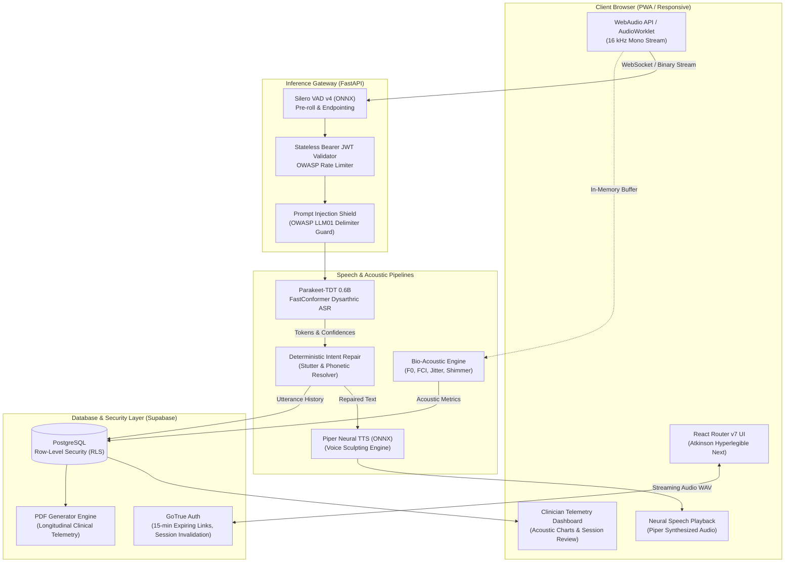
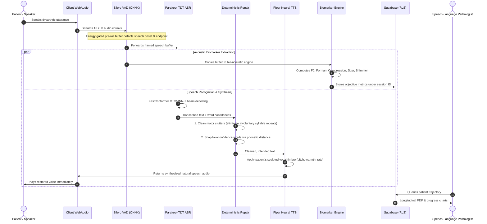
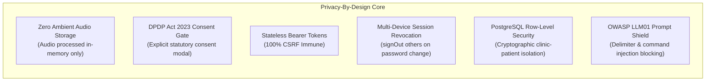
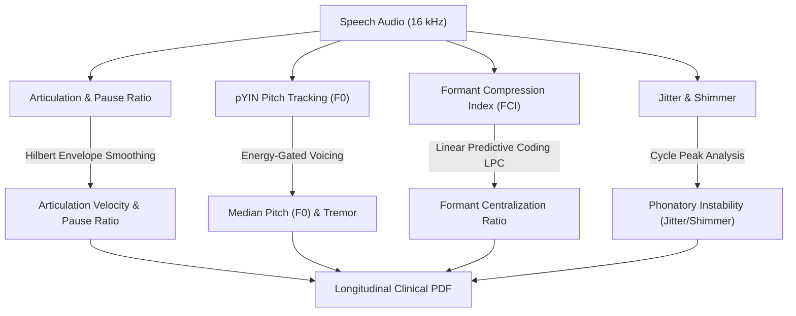

<p align="center">
  
</p>

# EPAKO

### Assistive Neural Speech Recognition, Real-Time Intent Repair, and Acoustic Telemetry for Dysarthria

[](LICENSE)
[](https://fastapi.tiangolo.com/)
[](https://reactrouter.com/)
[](https://huggingface.co/dys-asr/parakeet-tdt-0.6b-unconstrained-soup)
[](https://github.com/rhasspy/piper)
[](#patient-safety--privacy-measures)

---

## Overview

**Epako Voice** is a clinical-grade assistive speech platform engineered for individuals living with motor speech disorders and dysarthria (resulting from ALS, Parkinson's disease, Cerebral Palsy, or stroke). 

Traditional automatic speech recognition (ASR) systems degrade significantly on dysarthric speech due to articulatory undershoot, irregular phonation, and reduced speaking rate. Generative Large Language Models (LLMs) used for transcription post-processing introduce unacceptable clinical risks through hallucinations and data privacy leaks.

Epako Voice solves these challenges with an integrated three-pillar architecture:
1. **Low-Latency Dysarthric ASR**: Driven by a FastConformer transducer model fine-tuned on clinical speech corpora.
2. **Deterministic Dysfluency & Intent Repair**: A multi-tier phonetic and rule-based repair engine that removes involuntary motor repetitions and snaps ambiguous words without generative hallucinations.
3. **Objective Bio-Acoustic Telemetry**: Automatic extraction of Formant Compression Index (FCI), Jitter, Shimmer, and Articulation Velocity, surfaced directly to Speech-Language Pathologists (SLPs) through longitudinal clinical reports.

---

## Key Novelties & Scientific Innovations

| Innovation | Traditional Approach | Epako Voice Approach |
| :--- | :--- | :--- |
| **Acoustic Modeling** | Generic Whisper / Google Speech APIs (>65% Word Error Rate on moderate-to-severe dysarthria). | **FastConformer Parakeet-TDT (0.6B)** fine-tuned on dysarthric speech (~187 ms latency on consumer GPUs). |
| **Post-Correction** | Generative LLMs (GPT/Gemini) that risk confabulating words or changing the speaker's medical intent. | **Deterministic Multi-Tier Repair** using neuromotor stutter filtration, ARPAbet phonetic distance, and vocabulary snapping. |
| **Voice Restoration** | Generative deepfake voice cloning (compute-heavy, prone to robotic artifacts and misuse). | **Parametric Voice Sculpting & Banking** via on-device Piper ONNX neural voices with continuous warmth, roughness, pitch, and rate control. |
| **Clinical Telemetry** | Qualitative perceptual scales (e.g., Frenchay Dysarthria Assessment) conducted manually. | **Automated Acoustic Biomarker Extraction** ($F_0$, Formant Compression, Jitter, Shimmer) with longitudinal trend tracking. |
| **Data Augmentation** | Generic noise and speed perturbation. | **Physics-Based Synthetic Dysarthria Engine** simulating bradylalia, articulatory undershoot via IIR filtering, and involuntary pauses. |

---

## End-to-End System Architecture

Epako Voice consists of a modern SSR web application, a high-throughput Python FastAPI gateway, on-device neural acoustic pipelines, and a secure Supabase persistence layer.



---

## Data Flow Lifecycle

The following diagram tracks the lifecycle of an audio packet from speech onset to rectified playback:



---

## Patient Safety & Privacy Measures

Because Epako Voice handles clinical vocal data, patient safety and privacy are baked into the core architectural design:



### 1. Zero Ambient Audio Persistence
- **In-Memory Volatility**: Audio frames captured via the microphone are analyzed directly in RAM for speech recognition and acoustic biomarker extraction.
- **Immediate Discard**: Once acoustic features and transcripts are extracted, raw audio frames are immediately freed from memory. No audio is ever written to disk or third-party cloud buckets without separate, explicit voice-banking consent.

### 2. Statutory DPDP Act 2023 Consent Gate
- Prior to recording or session creation, patients must complete an explicit, purpose-limited statutory consent gate ([`ConsentModal.tsx`](web/app/components/ConsentModal.tsx)).
- Patients retain the unconditional right to withdraw consent and delete historical telemetry directly from their profile.

### 3. CSRF Immunity via Stateless Bearer Tokens
- Epako Voice eliminates session-hijacking and Cross-Site Request Forgery (CSRF) by using explicit `Authorization: Bearer <JWT>` request headers rather than ambient browser cookies.
- Cross-origin requests cannot transmit credentials silently.

### 4. Enterprise Session Lifecycle & Revocation
- **15-Minute Link Expiry**: Password reset tokens and magic links expire after 900 seconds (15 minutes).
- **Session Revocation on Password Update**: Changing a password immediately executes `supabase.auth.signOut({ scope: "others" })`, purging all stale sessions across all other active devices.

### 5. PostgreSQL Row-Level Security (RLS)
- Patient sessions, biomarker metrics, and clinical notes are isolated at the database engine level.
- Patients can only query their own records.
- Clinicians cannot access any patient data unless the patient has explicitly redeemed an invite link that establishes a cryptographically verified `clinician_patients` relationship.

### 6. Adversarial Input & Prompt Injection Shield
- User text inputs to the speech and voice sculpting endpoints are screened by [`src/prompt_guard.py`](src/prompt_guard.py) against OWASP LLM01 vulnerabilities, ChatML delimiter hijacking (`<|im_start|>`), and system instruction override attempts.

---

## Datasets & Download Links

The acoustic models, synthetic data pipelines, and validation suites in Epako Voice utilize the following open research corpora:

| Dataset | Description | Official Access / Download Link |
| :--- | :--- | :--- |
| **TORGO Speech Corpus** | Acoustic and 3D articulatory speech corpus from 8 dysarthric and 7 control speakers (Cerebral Palsy and ALS). | [University of Toronto TORGO Repository](http://www.cs.toronto.edu/~compling/Research/TORGO/torgo.html)<br>[Kaggle Verified Mirror](https://www.kaggle.com/datasets/iamhungundji/torgo-dysarthria-speech-dataset) |
| **UASpeech Database** | 19 speakers with cerebral palsy uttering isolated words across 4 severity levels (University of Illinois). | [UIUC Speech & Speech Technology (SST)](http://isle.illinois.edu/sst/data/UASpeech/) |
| **Speech Accessibility Project (SAP)** | Large-scale multi-pathology dysarthric speech corpus (Parkinson's, ALS, CP, Stroke, Down Syndrome). | [Speech Accessibility Project Portal](https://speechaccessibilityproject.beckman.illinois.edu/) |
| **Parakeet-TDT 0.6B Checkpoint** | FastConformer acoustic model checkpoint trained on Speech Accessibility Project data. | [Hugging Face (`dys-asr/parakeet-tdt-0.6b-unconstrained-soup`)](https://huggingface.co/dys-asr/parakeet-tdt-0.6b-unconstrained-soup) |
| **Piper Neural Voices** | Lightweight ONNX VITS speech synthesis models. | [Rhasspy Piper Models Repository](https://huggingface.co/rhasspy/piper-voices) |
| **Silero VAD** | Fast, enterprise-grade Voice Activity Detection ONNX model. | [Silero VAD GitHub Repository](https://github.com/snakers4/silero-vad) |

---

## Bio-Acoustic Biomarker Engine

Epako Voice extracts four clinically proven acoustic biomarkers from patient speech to track motor progress over time:



1. **Articulation Velocity & Pause Ratio**: Uses a Hilbert envelope with a 5 Hz Butterworth low-pass filter to count acoustic syllable peaks over active phonation, isolating motor hesitation from actual speech speed.
2. **Formant Compression Index (FCI)**: Computes the scatter and dispersion of $F_1$ and $F_2$ formants via Linear Predictive Coding (LPC). Articulatory undershoot in dysarthria manifests as a compressed vowel space.
3. **Phonatory Instability (Jitter & Shimmer)**: Measures cycle-to-cycle frequency variations (jitter) and amplitude variations (shimmer) in sustained voiced frames to detect laryngeal ataxia.
4. **Energy-Gated $F_0$ Tracking**: Leverages probabilistic YIN (pYIN) with strict spectral energy gating to prevent background room noise from skewing patient pitch baselines.

---

## Getting Started

### Prerequisites
- **Python**: 3.10 or 3.11
- **Node.js**: v18.0.0 or higher (v20+ recommended)
- **GPU (Optional)**: NVIDIA GPU with CUDA support for sub-200 ms FastConformer ASR (CPU inference supported).

### 1. Clone & Set Up the Repository
```bash
git clone https://github.com/Rick1055/Epako.git
cd Epako
```

### 2. Backend Setup
```bash
# Create and activate a Python virtual environment
python -m venv .venv
source .venv/bin/activate  # On Windows: .venv\Scripts\activate

# Install Python dependencies
pip install -r requirements.txt

# Download required Piper neural voice models into models/piper/
python -m piper.download_voices en_US-ryan-medium --download-dir models/piper
python -m piper.download_voices en_US-amy-medium --download-dir models/piper
```

### 3. Frontend Setup
```bash
cd web
npm install
npm run build
cd ..
```

### 4. Environment Variables
Create a `.env` file in the project root:
```env
SUPABASE_URL=https://your-supabase-project.supabase.co
SUPABASE_ANON_KEY=your-anon-key
SUPABASE_SERVICE_ROLE_KEY=your-service-role-key
PORT=8000
PIPER_VOICES_DIR=models/piper
```

And in `web/.env`:
```env
VITE_SUPABASE_URL=https://your-supabase-project.supabase.co
VITE_SUPABASE_ANON_KEY=your-anon-key
VITE_API_URL=http://127.0.0.1:8000
```

### 5. Running the Application
```bash
# Terminal 1: Launch FastAPI Gateway
python src/api.py

# Terminal 2: Launch React Router SSR Web Server
cd web
node server.js
```
Open **`http://127.0.0.1:3000`** in your browser to access Epako Voice.

---

## Test Suite & Verification

The project includes unit, clinical, and security attack test suites:

```bash
# Run backend security attack tests (OWASP LLM01, audio sanitization, auth validation)
pytest tests/test_attacks.py -v

# Run frontend TypeScript type-checking
cd web && npm run typecheck

# Run accessibility & color contrast audit (WCAG AA compliance)
node scripts/check-contrast.mjs
```

---

## Clinical Disclaimer

> [!IMPORTANT]
> **Epako Voice is an assistive communication aid and therapy accompaniment. It is not an FDA/MDR-cleared medical diagnostic device.** Clinical biomarker tracking and longitudinal PDF exports are designed to support and augment, not replace, formal assessments by certified Speech-Language Pathologists (SLPs) and medical practitioners.

---

## License

This project is licensed under the [MIT License](LICENSE).
